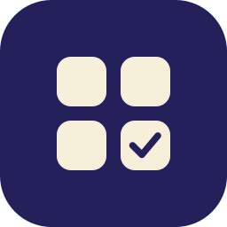
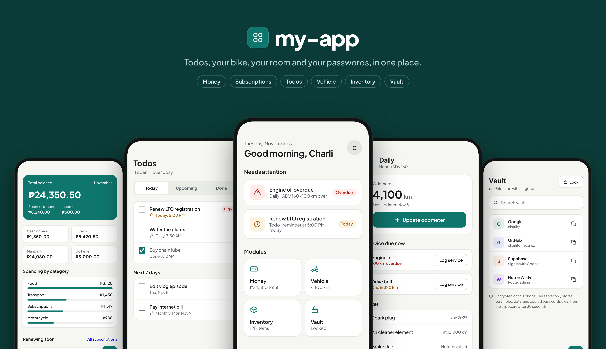
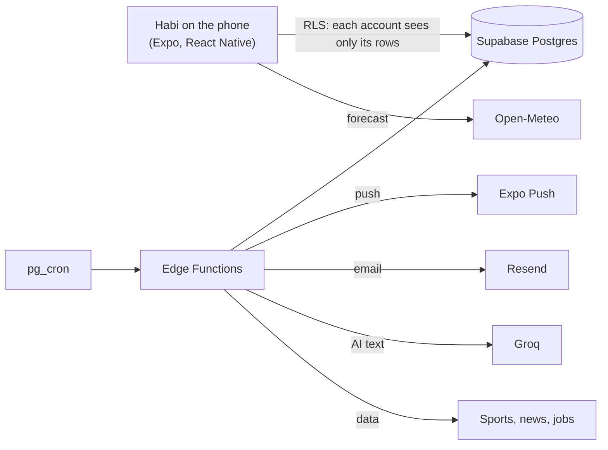

<div align="center">



# Habi

### One private app that tells you what needs you today.

**Todos, money, the ADV 160's service schedule, a password vault and 18 more modules, in one Android app.**

[](https://github.com/charlitomecarez/habi/actions/workflows/ci.yml)
[](CHANGELOG.md)
[](https://expo.dev)
[](https://supabase.com)
[](#install-on-android)
[](LICENSE)

<br />

<code>npm install && npm run web</code>

</div>

> [!IMPORTANT]
> Habi is a private app. Sign-up is off: only people the admin adds can sign in, and each account has fully separate data.
> The APK comes from Build from GitHub in expo.dev, not the Play Store. To run your own copy, follow [CONTRIBUTING.md](CONTRIBUTING.md).

<div align="center">

<br />



<br /><br />

</div>

---

Habi is one personal assistant for a real life in the Philippines: the ADV 160 and its kilometres, GCash and MariBank, ulam under ₱99, and voice messages in Taglish. Home says in one sentence what needs you, and every module feeds it. It runs on Android first and on the web second, and everything stays on free tiers.

> **[Read the release records](docs/releases/index.md)** for each version's plan, design, handoff and release notes.

## Quick start

### Install on Android

1. On the phone, sign in to expo.dev and open the latest `preview` or `production` build.
2. Download the APK, and open the file.
3. If Android asks, allow installs from that app, then tap **Install**.
4. Open Habi and sign in with Google.

To update, install the APK from a newer build over the current app. Your data stays in Supabase, but checks, sleep, steps, screen time and the saved weather place stay on the phone.

The app does not run in Expo Go, because it has its own native modules. Expo Go shows a blank screen.

### Run your own copy

```sh
git clone https://github.com/charlitomecarez/habi.git
cd habi
npm install
cp .env.example .env   # then fill in the three values
```

[CONTRIBUTING.md](CONTRIBUTING.md) walks through your own Supabase project, Google sign-in, Firebase and the Edge Functions. A module whose key you leave out hides itself.

### Use the web app

```sh
npm run web
```

The web build covers most screens. Widgets, Health Connect, sleep, screen time, alarms and the vault PIN need the APK. Stop the dev server when you finish.

## How Habi works



- **The app speaks first.** Modules write rows to `reminders`, and only `send-reminders` sends notifications. Alarms are the one exception: they ring from the phone, because a push can arrive late.
- **Each account is separate.** Every user-owned table has row-level security, so one account never reaches another's rows.
- **Private by default.** The vault is encrypted on the phone before it reaches Supabase. Steps, sleep and screen time never leave the phone.
- **Keys stay on the server.** The app ships only the Supabase URL, the anon key and the Google web client id. Every other key lives in Edge Function secrets.

## What's inside

The tabs are Home, Money, Todos, Vehicle and More. More is a searchable grid of everything else, and Settings › Modules hides what you do not use.

| Module                          | What you get                                                                                                                                                                               | Needs                                     |
| ------------------------------- | ------------------------------------------------------------------------------------------------------------------------------------------------------------------------------------------ | ----------------------------------------- |
| **Home**                        | One sentence on what needs you, the week band (money, todos, habits, sleep), today's rows, weather, steps, screen time, the latest games of teams you follow, headlines and your shortcuts | —                                         |
| **Money**                       | Week chart, account cards, transactions, bills, budgets, savings goals, subscriptions, recurring entries and exchange rates                                                                | —                                         |
| **Statement import**            | GoTyme, GCash and MariBank PDFs, with a review before anything saves                                                                                                                       | `GOTYME_KEY`, `GCASH_KEY` for locked PDFs |
| **Todos**                       | Due dates, repeats and reminders                                                                                                                                                           | —                                         |
| **Vehicle**                     | Odometer, service schedule and log, fuel logs, and before-riding and weekly checks. Honda ADV 160 by default                                                                               | —                                         |
| **Habits, Gym, Journal**        | Streaks, workout plans and sessions, and a journal calendar                                                                                                                                | —                                         |
| **Health**                      | Medicine doses, doctor visits, steps from Health Connect, and sleep from when your screen is off                                                                                           | Android for steps and sleep               |
| **Screen time**                 | Every app you used today or this week                                                                                                                                                      | Android usage access                      |
| **Alarms**                      | Alarms that ring from the phone, with a scan or sums to stop them                                                                                                                          | Android                                   |
| **Ulam**                        | A daily dish under your limit, with a photo                                                                                                                                                | `GROQ_API_KEY` (else a bundled list)      |
| **Sports**                      | Five football leagues and the NBA, with logos and standings, and teams you follow                                                                                                          | `FOOTBALL_DATA_KEY`, `BALLDONTLIE_KEY`    |
| **Weather**                     | The forecast for a place you pick                                                                                                                                                          | —                                         |
| **News**                        | Philippine and world headlines with images and summaries, and the full story in the app                                                                                                    | —                                         |
| **People, Debts**               | Birthdays, yearly dates, gift ideas, and who owes whom                                                                                                                                     | —                                         |
| **Inbox**                       | Voice messages with text, between the admin and the accounts the admin ticks                                                                                                               | `GROQ_API_KEY`                            |
| **Inventory, Shopping, Travel** | Items with photos, places and QR box labels; a shopping list; trip plans                                                                                                                   | —                                         |
| **Find a work**                 | Ranked job matches and cover letter drafts (admin only)                                                                                                                                    | `GROQ_API_KEY`                            |
| **Documents**                   | Expiry dates, renewal reminders and encrypted photos                                                                                                                                       | —                                         |
| **Vault**                       | Passwords encrypted on the phone, with fingerprint or PIN unlock and a recovery key                                                                                                        | —                                         |
| **Content**                     | A video planner                                                                                                                                                                            | —                                         |

Android also has two home screen widgets, Sleep and Screen time. Report a bug is on More.

## Vault security

The phone encrypts each vault entry with XChaCha20-Poly1305 before it goes to Supabase. The vault key is locked with a key from your master password (Argon2id, 3 passes over 64 MiB), and Supabase never gets the plaintext, the key or the password.

- **PIN and fingerprint** unlock the vault on your phone only. 5 wrong PINs turn the PIN off.
- **Recovery key:** 28 characters that you write down. With a code to your sign-in email, it resets a forgotten master password. Without it, nobody can open the vault, not even the server.
- [docs/modules/vault.md](docs/modules/vault.md) has the full design.

## FAQ

<details>
<summary><strong>Is Habi on the Play Store?</strong></summary>

No. The APK comes from Build from GitHub in expo.dev. GitHub releases hold only the source code.

</details>

<details>
<summary><strong>Can a friend use my copy?</strong></summary>

Only if the admin adds them. Sign-up is off, and each account sees only its own data. Only the admin decides who gets voice messages.

</details>

<details>
<summary><strong>What stays on the phone?</strong></summary>

Steps, sleep, screen time, before-riding checks and the saved weather place. The vault key stays in memory while the vault is open, and the PIN and fingerprint copies stay in Android's secure store.

</details>

<details>
<summary><strong>What if I forget the vault master password?</strong></summary>

Use **Forgot master password?** on the lock screen: a code to your email, then your recovery key, then a new master password. Without a recovery key, the vault cannot be opened.

</details>

<details>
<summary><strong>Does it cost anything?</strong></summary>

No. Supabase, Resend, Groq, Gemini, Expo Push, Open-Meteo, the sports APIs and the news feeds are all used on their free plans.

</details>

<details>
<summary><strong>Why don't I see Sports, Inbox or Find a work?</strong></summary>

That copy's server has no key for them, so they hide themselves. You can also hide any module in Settings › Modules.

</details>

<details>
<summary><strong>Does it work on iPhone?</strong></summary>

Not yet. This release targets Android. The web build works in any browser, without the Android-only parts.

</details>

<details>
<summary><strong>How do I report a bug?</strong></summary>

Use **Report a bug** at the bottom of More. The admin sees it under Reports.

</details>

## For developers

<details>
<summary><strong>Stack</strong></summary>

- Expo SDK 58 with expo-router and a development client; TypeScript, NativeWind 4 and the Schibsted Grotesk font. The look is Banig: see [docs/design-system.md](docs/design-system.md).
- Supabase: Postgres with RLS, Auth, Storage, Edge Functions, pg_cron and pg_net.
- @tanstack/react-query, zustand, react-hook-form with zod, and date-fns.
- Expo Push for notifications, Resend for email, Gemini for the daily tip, and Groq for the ulam, voice text and Find a work.
- Open-Meteo for weather, football-data.org and balldontlie for sports, public RSS feeds for news, freehire for jobs, and Wikimedia Commons for ulam photos.
- Health Connect for steps, `react-native-android-widget` for the widgets, and react-native-libsodium for the vault.
- pdfjs-dist in the `import-statement` and `job-profile-draft` Edge Functions.

</details>

<details>
<summary><strong>Requirements and set up</strong></summary>

- Node 22 (`.nvmrc`) and an expo.dev account connected to this repository.
- The Supabase CLI is a dev dependency, so run it with `npx supabase`. Docker and a local Supabase server are not used.
- `.env` holds three values: `EXPO_PUBLIC_SUPABASE_URL`, `EXPO_PUBLIC_SUPABASE_ANON_KEY` and `EXPO_PUBLIC_GOOGLE_WEB_CLIENT_ID`. They are safe in the app bundle. Never give any other value the `EXPO_PUBLIC_` prefix, and never commit a secret.
- For live changes on a phone, install a `development` build and run `npx expo start --dev-client`.

</details>

<details>
<summary><strong>Database</strong></summary>

The schema is in `supabase/migrations/`. Every user-owned table has row-level security.

```sh
npx supabase link --project-ref <project-ref>
npx supabase db push --remote
npm run db:types
```

Add a new migration file for each schema change. Do not edit a migration that is already applied. Never run `supabase config push`.

</details>

<details>
<summary><strong>Edge Functions</strong></summary>

| Function            | What it does                                               | How it runs                   |
| ------------------- | ---------------------------------------------------------- | ----------------------------- |
| `send-reminders`    | Sends push notifications and one digest email per day      | pg_cron, every 15 minutes     |
| `daily-tip`         | Stores one short tip from the Gemini API                   | pg_cron, 12:00 AM Manila time |
| `daily-ulam`        | Picks three dishes under the limit with Groq               | pg_cron, 12:05 AM Manila time |
| `voice-cleanup`     | Deletes voice audio after 7 days and keeps the text        | pg_cron, 1:00 AM Manila time  |
| `job-search`        | Finds and ranks jobs, and drafts a cover letter on request | pg_cron, 6:00 AM, and the app |
| `sports-sync`       | Stores matches and standings for six leagues               | pg_cron, 7:00 AM and 3:00 PM  |
| `news-sync`         | Stores headlines and summaries from public RSS feeds       | pg_cron, every 2 hours        |
| `app-features`      | Says which keyed modules this server can run (yes or no)   | The app, on start             |
| `import-statement`  | Reads one PDF statement in memory and stores nothing       | The app, for a signed-in user |
| `voice-transcribe`  | Turns a voice message into text with Groq                  | The app, for a signed-in user |
| `job-profile-draft` | Reads a resume PDF in memory and drafts a work profile     | The app, for the admin        |

Recurring money, subscription expenses and medicine doses run in SQL through pg_cron, so they need no function.

```sh
npx supabase secrets set CRON_SECRET=<random string> RESEND_API_KEY=<key> GEMINI_API_KEY=<key> GROQ_API_KEY=<key> GOTYME_KEY=<key> GCASH_KEY=<key> FOOTBALL_DATA_KEY=<key> BALLDONTLIE_KEY=<key>
npx supabase functions deploy --use-api
```

In the Supabase SQL editor, store the project URL and the same cron secret:

```sql
select vault.create_secret('https://<project-ref>.supabase.co', 'project_url');
select vault.create_secret('<random string>', 'reminders_cron_secret');
```

The Google client secret, the service-role key and every key above stay in the Supabase dashboard or the function secrets.

</details>

<details>
<summary><strong>Checks, builds and backup</strong></summary>

```sh
npm run typecheck
npm run lint
npm test
npx prettier --check .
```

- Run them one at a time: the development Mac has 8 GB of RAM. Vitest runs `lib/**/*.test.ts` and `supabase/functions/_shared/**/*.test.ts`.
- After you add a route, run `npx expo customize tsconfig.json` to refresh the route types.
- Build the APK only with Build from GitHub in expo.dev, with the `development`, `preview` or `production` profile in `eas.json`. Do not build on the Mac, and do not use `eas build`. Never attach the APK to a GitHub release.
- A GitHub Actions job makes an encrypted database dump each day at 3:10 AM Manila time. [docs/backup.md](docs/backup.md) has the restore steps.

</details>

<details>
<summary><strong>Project layout</strong></summary>

- `app/(auth)/`: the sign-in screen, the only public screen besides the alarm ringing screen.
- `app/(app)/`: the protected screens.
- `components/ui/`: the shared components. Build screens from these.
- `components/<module>/`: the forms and parts for one module.
- `lib/`: data hooks and helpers. Android-only APIs use a `name.ts` and `name.web.ts` pair.
- `modules/`: the local native modules `alarm`, `screen-time` and `secure-clipboard`.
- `widgets/`: the Sleep and Screen time home screen widgets.
- `supabase/`: the migrations, the Edge Functions and the email templates.
- `tailwind.config.js` and `global.css`: the design tokens for the light and dark themes.

</details>

## Documentation

- [CONTRIBUTING.md](CONTRIBUTING.md): set up your own copy from nothing.
- [docs/architecture.md](docs/architecture.md): how the app, Supabase and the functions fit together.
- [docs/database.md](docs/database.md): every table, its RLS and its triggers.
- [docs/design-system.md](docs/design-system.md): the Banig tokens and the shared components.
- [docs/modules/](docs/modules): one page for each module.
- [docs/reminders.md](docs/reminders.md): how notifications and the digest are sent.
- [docs/backup.md](docs/backup.md): the daily encrypted backup and how to restore it.
- [docs/releases/index.md](docs/releases/index.md) and [CHANGELOG.md](CHANGELOG.md): every release.

## License

[MIT](LICENSE). You can use, copy, change and share the code, as long as you keep the copyright notice.
